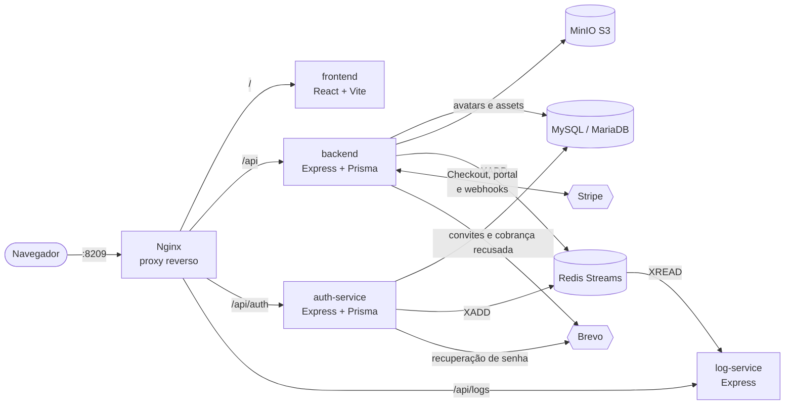

<div align="center">


# Kreato

**Planejamento e produção de conteúdo para criadores e equipes pequenas, da ideia ao ar num quadro só.**

[](https://github.com/guilherme-dds/kreato/actions/workflows/ci.yml)


[Sistema no ar](#-sistema-no-ar) ·
[Começando](#começando) ·
[Arquitetura](#arquitetura) ·
[Plano de negócio](#plano-de-negócio) ·
[API e Swagger](#api) ·
[Documentação técnica](documentacao.md)

</div>

---

O Kreato junta num só lugar o que o criador de conteúdo hoje espalha entre Notion, Trello e planilhas: o banco de ideias, o roteiro, a gravação, a edição, a agenda de publicação e as métricas. Cada conteúdo anda por um quadro de seis etapas, e em equipe cada pessoa vê e move só o que é da etapa dela.

O projeto é desenvolvido na disciplina **Introdução à Computação em Nuvem (ISW055)**, sob orientação do professor [@siriani](https://github.com/siriani). Ele nasceu como o catálogo de filmes das primeiras atividades ([guilherme-dds/movie-catalog](https://github.com/guilherme-dds/movie-catalog)) e virou este SaaS, com o histórico de commits preservado.

## 🌐 Sistema no ar

|                |                                                                                        |
| -------------- | -------------------------------------------------------------------------------------- |
| **Aplicação**  | `https://guilherme-santos-isw055.lapps.studio`                                         |
| **Deploy**     | Stack do Portainer construída a partir deste repositório                               |
| **Pagamentos** | Stripe em **modo de teste** (cartão `4242 4242 4242 4242`, qualquer data futura e CVC) |

## Índice

- [Funcionalidades](#funcionalidades)
- [Começando](#começando)
- [Arquitetura](#arquitetura)
- [Classificação IaaS, PaaS e SaaS](#classificação-iaas-paas-e-saas)
- [Permissões (RBAC)](#permissões-rbac)
- [Decisões técnicas](#decisões-técnicas)
- [Assinatura com Stripe](#assinatura-com-stripe)
- [Plano de negócio](#plano-de-negócio)
- [API](#api)
- [CI/CD e segredos](#cicd-e-segredos)
- [Estrutura do repositório](#estrutura-do-repositório)
- [Histórico das entregas](#histórico-das-entregas)
- [Autor](#autor)

## Funcionalidades

|                           |                                                                                                                                         |
| ------------------------- | --------------------------------------------------------------------------------------------------------------------------------------- |
| **Banco de ideias**       | Captura rápida com gancho, legenda, plataforma, tags e status, com busca e filtros. Uma ideia vira conteúdo no quadro com um clique.    |
| **Pipeline de produção**  | Kanban com as etapas Ideia, Roteiro, Gravação, Edição, Agendado e Publicado, arrastar e soltar e editor de roteiro, legenda e hashtags. |
| **Revisão de roteiro**    | Comentários por conteúdo, aprovação do roteiro e pedido de ajustes pelo gestor. Só roteiro aprovado segue para a gravação.              |
| **Calendário editorial**  | Grade mensal das publicações, com reagendamento arrastando o card.                                                                      |
| **Anexos (MinIO)**        | Vídeos brutos, áudios, imagens e PDFs ligados a cada conteúdo, no bucket `assets`.                                                      |
| **Métricas**              | Views, curtidas, comentários, compartilhamentos e salvamentos, com taxa de engajamento e comparação por plataforma e formato.           |
| **Dashboard**             | Meta semanal de publicações, sequência de semanas cumpridas, agenda e destaques.                                                        |
| **Equipes e workspaces**  | Convites por e-mail, papéis Dono, Gestor, Roteirista e Editor, e troca entre workspaces.                                                |
| **Planos e assinatura**   | Gratuito, Creator e Studio com cobrança mensal no Stripe, portal do cliente, webhooks e limites aplicados na API.                       |
| **Painel administrativo** | Usuários por plano, assinaturas ativas, MRR de teste e os últimos eventos de auditoria, inclusive os webhooks do Stripe.                |
| **Sessão segura**         | JWT de 15 minutos em memória, refresh token em cookie httpOnly com rotação e recuperação de senha por e-mail com link de 30 minutos.    |
| **Auditoria**             | Eventos de uso e segurança publicados com `XADD` no Redis Streams e consumidos pelo `log-service`.                                      |
| **Landing page**          | Página pública em `/` para quem não está logado, com o quadro de produção e a comparação dos planos.                                    |

## Começando

**Pré-requisitos:** Docker com Docker Compose e um MySQL/MariaDB acessível.

```bash
git clone https://github.com/guilherme-dds/kreato.git
cd kreato
cp .env.example .env    # preencha os valores; nada real vai para o repositório
docker compose up --build -d
```

Ao subir, o `backend` sincroniza o banco com o `prisma/schema.prisma` (`prisma db push`, sem `--accept-data-loss`). Mudanças que apagariam dados param o deploy com uma mensagem no log, para serem aplicadas à mão. O SQL versionado das mudanças de dados fica em [`backend/prisma/sql/`](backend/prisma/sql).

| Endereço                             | O que é                             |
| ------------------------------------ | ----------------------------------- |
| `http://localhost:8209`              | Aplicação web e API, atrás do Nginx |
| `http://localhost:8209/api/docs`     | Swagger do `backend`                |
| `http://localhost:8209/auth/apidocs` | Swagger do `auth-service`           |
| `http://localhost:8209/log/apidocs`  | Swagger do `log-service`            |

<details>
<summary><b>Variáveis de ambiente</b></summary>

<br>

O modelo com **todos os nomes** está em [`.env.example`](.env.example), sem nenhum valor real. Em produção, as mesmas variáveis ficam na stack do Portainer.

| Grupo        | Variáveis                                                                                                             |
| ------------ | --------------------------------------------------------------------------------------------------------------------- |
| Obrigatórias | as do banco (`DATABASE_URL` e afins), `JWT_SECRET`, `MINIO_ROOT_USER`, `MINIO_ROOT_PASSWORD`                          |
| E-mail       | `FRONTEND_URL`, `BREVO_API_KEY` e `BREVO_SENDER_EMAIL` (ou Mailtrap em desenvolvimento)                               |
| Assinatura   | `STRIPE_SECRET_KEY`, `STRIPE_PUBLISHABLE_KEY`, `STRIPE_WEBHOOK_SECRET`, `STRIPE_PRICE_CREATOR`, `STRIPE_PRICE_STUDIO` |

Sem `STRIPE_SECRET_KEY`, o app entra em modo simulado (planos ativados sem cartão). Esse modo fica desligado sempre que o Stripe está configurado.

</details>

<details>
<summary><b>Testes</b></summary>

<br>

```bash
cd backend
npm test
```

Os testes cobrem permissões por papel, limites de assentos, validação de requisições e as regras de assinatura. Eles rodam no CI a cada push.

</details>

## Arquitetura

Só o Nginx publica porta no host. Os serviços conversam pela rede interna do Docker; o `auth-service` e o `log-service` não são acessíveis de fora.



| Serviço        | Papel                                                                                                                       |
| -------------- | --------------------------------------------------------------------------------------------------------------------------- |
| `nginx`        | Única porta publicada (8209). Roteia o frontend e cada API e aplica os cabeçalhos de segurança.                             |
| `frontend`     | SPA em React 19. Guarda o access token só em memória.                                                                       |
| `backend`      | Domínio do produto: workspaces, ideias, conteúdos, revisão, anexos, métricas, planos e Stripe. É o dono do schema do banco. |
| `auth-service` | Cadastro, login, refresh token com rotação, logout e redefinição de senha.                                                  |
| `log-service`  | Lê o Redis Stream e expõe o histórico e as estatísticas de auditoria para admins.                                           |
| `redis`        | Fila de eventos de auditoria (Redis Streams).                                                                               |
| `minio`        | Object storage S3 com os buckets `avatars` e `assets`.                                                                      |

O diagrama completo, o modelo de dados e as regras de negócio extraídas do código estão em [`documentacao.md`](documentacao.md).

## Classificação IaaS, PaaS e SaaS

| Peça                                      |       Camada       | Justificativa                                                                                                                                                          |
| :---------------------------------------- | :----------------: | :--------------------------------------------------------------------------------------------------------------------------------------------------------------------- |
| **Máquina virtual**                       |      **IaaS**      | Entrega o hardware virtualizado (CPU, memória, disco e rede) e o sistema operacional onde o Docker roda.                                                               |
| **Contêineres (Docker / Docker Compose)** | **PaaS** _(CaaS)_  | Dão o runtime padronizado dos serviços (`backend`, `auth-service`, `log-service`, `frontend`, `nginx`, `redis`, `minio`), sem administrar o SO da máquina diretamente. |
| **Portainer**                             |      **PaaS**      | Plataforma de orquestração visual e de ciclo de vida dos contêineres, sem operar a VM pelo terminal.                                                                   |
| **Banco de dados (MySQL)**                | **PaaS** _(DBaaS)_ | Banco relacional gerenciado; ninguém do projeto cuida do servidor nem do SO do banco.                                                                                  |
| **Stripe**                                |      **SaaS**      | Software pronto de checkout e cobrança recorrente, que assume a conformidade PCI-DSS. O Kreato só consome APIs e webhooks.                                             |
| **Brevo / Mailtrap**                      |      **SaaS**      | Envio e monitoramento de e-mails transacionais por API, sem servidor SMTP próprio.                                                                                     |
| **GitHub Actions**                        |      **SaaS**      | Esteira de CI pronta: o repositório só descreve o workflow, e o GitHub fornece e mantém os executores.                                                                 |

## Permissões (RBAC)

As permissões valem **no servidor**: chamar a API direto, sem a tela, recebe o mesmo `403`. Toda ação negada vira um evento de auditoria.

**Role da conta**

- **`creator`** (padrão de todo cadastro): usa o Kreato nos workspaces de que participa, edita só o próprio perfil e a própria foto.
- **`admin`**: tudo o que o `creator` faz e, além disso, acessa o painel administrativo, as métricas da plataforma e os logs de auditoria. A role é atribuída direto no banco.

**Papel no workspace**

| Papel          | O que pode fazer                                                                                            |
| -------------- | ----------------------------------------------------------------------------------------------------------- |
| **Dono**       | Tudo, inclusive plano e assinatura. Gerencia gestores.                                                      |
| **Gestor**     | Gerencia conteúdos em todas as etapas, aprova roteiros, agenda e publica, e convida roteiristas e editores. |
| **Roteirista** | Cria e escreve conteúdos nas etapas Ideia e Roteiro.                                                        |
| **Editor**     | Move conteúdos entre Gravação e Edição.                                                                     |

Todos os membros comentam, enviam anexos e registram métricas. Os limites de uso seguem o plano do dono do workspace.

**Qual padrão de enforcement o projeto usa?** O **Padrão B (claims no JWT)**. O `backend` e o `log-service` verificam o token localmente com o `JWT_SECRET` compartilhado e leem o `id` e a `role` dele, sem chamada de rede por requisição. A exceção são as rotas de admin do `backend`: o `AdminMiddleware` confere a role no banco, para que um admin rebaixado perca o acesso na hora, sem esperar o token vencer. Se o `JWT_SECRET` não estiver no serviço, o middleware já cai no **Padrão A** e pergunta ao `auth-service` (`POST /auth/verify`).

Para ir de vez ao Padrão A, bastaria tirar o `JWT_SECRET` dos serviços e fazer o `/auth/verify` devolver também as permissões. Cada ação passaria a depender de uma ida ao `auth-service`: revogação instantânea, mas mais latência e um ponto único de falha.

## Decisões técnicas

**Exibição das imagens: proxy pelo backend, bucket privado.** Os buckets do MinIO não têm leitura pública e não usamos URL pré-assinada. O banco guarda só a referência do arquivo, e o navegador busca a imagem por uma rota do `backend` (`GET /api/user/avatar/:filename` para avatares, `GET /api/anexos/:id/arquivo` para anexos), que lê o objeto e o repassa. Assim o MinIO nunca fica exposto, os anexos passam pela checagem de acesso ao workspace e o endereço não expira. O custo é o tráfego passar pelo `backend`, compensado nos avatares por `Cache-Control` de um dia. O upload aceita só imagens de até 5 MB.

**Auditoria com Redis Streams, não lista simples.** O `XADD` grava cada evento com ID ordenado no tempo e o `log-service` lê com `XREAD`. Diferente de uma lista com `LPUSH`, o stream mantém o histórico para consulta e permite reler a partir de um ponto. Cada evento leva `usuarioId`, ação, data e IP de origem.

**O plano vem só dos webhooks.** A volta do checkout para o app não muda nada: a tela espera o webhook do Stripe gravar a assinatura no banco. Detalhes na seção seguinte.

## Assinatura com Stripe

O Kreato cobra por assinatura mensal, sempre no **modo de teste** do Stripe. Quem sabe o estado verdadeiro da assinatura é o Stripe. O banco guarda uma cópia (`plano`, `statusAssinatura`, `valorMensalCentavos`, `stripeCustomerId` e `stripeSubscriptionId`) mantida **só pelos webhooks**, e nenhum dado de cartão.

### Planos

| Plano              | Preço mensal | Ideias     | Conteúdos em produção | Anexos | Histórico de métricas | Membros |
| ------------------ | ------------ | ---------- | --------------------- | ------ | --------------------- | ------- |
| **Gratuito**       | R$ 0,00      | 50         | 15                    | 100 MB | 30 dias               | 1       |
| **Kreato Creator** | R$ 29,90     | ilimitadas | ilimitados            | 2 GB   | completo              | 1       |
| **Kreato Studio**  | R$ 79,90     | ilimitadas | ilimitados            | 10 GB  | completo              | 5       |

Os limites valem **na API** a cada requisição, com o plano lido do banco. Ao estourar um limite, a API responde `403` com `code: "PLAN_LIMIT_REACHED"`, o limite atingido e como liberar. Exemplo: _"Você atingiu o limite de 15 conteúdos em produção do seu plano. Publique ou exclua conteúdos, ou faça upgrade."_

### Webhooks (`POST /api/stripe/webhook`)

| Evento                          | O que muda no banco                                                                                                          |
| ------------------------------- | ---------------------------------------------------------------------------------------------------------------------------- |
| `checkout.session.completed`    | Guarda o customer e a subscription no usuário e libera o plano pago.                                                         |
| `customer.subscription.updated` | Atualiza plano, status (`active`, `past_due`, `canceled`…) e valor mensal. Uma troca pelo portal muda o plano pelo Price ID. |
| `customer.subscription.deleted` | Volta o usuário ao Gratuito.                                                                                                 |
| `invoice.payment_failed`        | Marca a assinatura como inadimplente, suspende o plano pago e avisa o usuário por e-mail e no app.                           |

- A assinatura de todo evento é validada com `STRIPE_WEBHOOK_SECRET` sobre o corpo bruto.
- O estado da assinatura é sempre buscado no Stripe, então a ordem de chegada dos eventos não importa.
- O `id` de cada evento é gravado na tabela `StripeEvento`, na mesma transação da mudança. Um evento reenviado responde `200` sem efeito.
- Cada webhook vira um evento de auditoria (`STRIPE_*`) e aparece em **Últimos eventos** no painel admin.

<details>
<summary><b>Configuração no painel do Stripe</b></summary>

<br>

1. **Produtos:** crie _Kreato Creator_ e _Kreato Studio_, cada um com preço **recorrente mensal em BRL**. Copie os Price IDs para `STRIPE_PRICE_CREATOR` e `STRIPE_PRICE_STUDIO`.
2. **Portal do cliente** (_Settings → Billing → Customer portal_): permita trocar entre Creator e Studio, atualizar a forma de pagamento e cancelar. Para testar na hora, configure o cancelamento **imediato**.
3. **Webhook** (_Developers → Webhooks_): endpoint `https://<seu-domínio>/api/stripe/webhook` com os quatro eventos acima. O _signing secret_ vai em `STRIPE_WEBHOOK_SECRET`.
4. **Variáveis:** as `STRIPE_*` ficam **só nas variáveis da stack no Portainer**.

Para testar localmente, a Stripe CLI encaminha os eventos:

```bash
stripe listen --forward-to localhost:8209/api/stripe/webhook
```

</details>

## Plano de negócio

### 1. Kreato

Organiza a produção de vídeos curtos, da ideia à publicação, para criadores de conteúdo e equipes pequenas.

### 2. A dor

Quem publica com frequência em TikTok, Instagram e YouTube perde tempo procurando a ideia anotada no celular, o roteiro num documento e a data numa planilha. O custo aparece em **tempo** (horas por semana só reorganizando), em **dinheiro** (publi atrasada ou entregue fora do combinado) e em **alcance** (semanas sem postar quebram a frequência que o algoritmo premia). Hoje a solução é juntar Notion, Trello, planilhas e grupos de WhatsApp, e a cada etapa alguém pergunta "em que pé está?".

### 3. Persona

**Ana, 19 anos**, cria vídeos de rotina e organização para TikTok e Reels e fatura com publis. Grava de manhã, edita à noite e conta com um editor freelancer duas vezes por semana. Ela quer manter cinco vídeos por semana e cumprir os prazos das marcas. O que atrapalha: as ideias ficam nas notas do celular, o roteiro aprovado se perde no WhatsApp com o editor e ela só descobre o atraso de uma publi quando a marca cobra.

### 4. Concorrentes e alternativas

| Alternativa            | O que faz mal para esse público                                                                                                |
| ---------------------- | ------------------------------------------------------------------------------------------------------------------------------ |
| **Notion**             | Flexível demais: o criador precisa montar e manter o próprio sistema, sem etapas de produção prontas nem aprovação de roteiro. |
| **Trello**             | Kanban genérico: não tem roteiro com tempo de fala, calendário editorial nem métricas por conteúdo.                            |
| **Planilhas**          | Não avisam nada, não guardam arquivos e viram bagunça quando mais de uma pessoa edita.                                         |
| **Grupos de WhatsApp** | Versões de roteiro e arquivos se perdem na conversa; não existe status de cada vídeo.                                          |

### 5. Proposta de valor

Um quadro feito para a produção de vídeo, com etapas, papéis e aprovação de roteiro prontos, que substitui as quatro ferramentas acima sem precisar montar nada.

### 6. Modelo de receita com Stripe

Freemium com assinatura mensal no Stripe: **Gratuito** (R$ 0), **Kreato Creator** (R$ 29,90) e **Kreato Studio** (R$ 79,90), com os limites da [tabela de planos](#planos). O Gratuito limita a 50 ideias, 15 conteúdos em produção, 100 MB de anexos, 30 dias de histórico de métricas e uma pessoa. Quem publica toda semana estoura esses limites: o Creator tira os limites para quem trabalha sozinho, e o Studio libera a equipe de até cinco pessoas com papéis e aprovação.

### 7. Métricas de sucesso

- **Assinantes:** contas no Creator e no Studio, e a conversão do Gratuito para pago.
- **MRR:** receita recorrente mensal, calculada no painel admin a partir das assinaturas ativas.
- **Retenção:** assinantes que continuam pagando mês a mês e a taxa de cancelamento (_churn_).

### 8. Lean Canvas

| Bloco                          | Descrição                                                                                                                                                                                                                                                                                                           |
| :----------------------------- | :------------------------------------------------------------------------------------------------------------------------------------------------------------------------------------------------------------------------------------------------------------------------------------------------------------------ |
| **1. Problema**                | 1. Ideias, roteiros e calendários ficam espalhados em diferentes ferramentas.<br>2. Dificuldade para manter uma frequência consistente de publicações.<br>3. Falta de organização e acompanhamento do processo de produção e dos resultados.<br><br>**Alternativas atuais:** Notion, Trello, planilhas e anotações. |
| **2. Segmentos de clientes**   | Criadores de conteúdo em geral, de iniciantes a profissionais que publicam em TikTok, Instagram, YouTube e outras redes. Inclui influenciadores, produtores de conteúdo digital e pequenas equipes de criação.                                                                                                      |
| **3. Proposta única de valor** | Tudo o que você precisa para planejar, organizar e acompanhar seus conteúdos em um só lugar. O Kreato centraliza o fluxo de produção para ajudar criadores a economizar tempo, manter a consistência e melhorar seus resultados.                                                                                    |
| **4. Solução**                 | 1. Central de ideias e roteiros: registre temas, ganchos, legendas e organize suas ideias.<br>2. Gestão da produção: acompanhe cada conteúdo em um pipeline e planeje publicações com um calendário editorial.<br>3. Acompanhamento de resultados: registre métricas e compare o desempenho dos conteúdos.          |
| **5. Canais**                  | TikTok, Instagram e YouTube para divulgar o produto; parcerias com criadores; comunidades de criadores; vídeos demonstrativos da plataforma; indicações entre usuários.                                                                                                                                             |
| **6. Fontes de receita**       | Modelo freemium com assinatura mensal: **Gratuito** com limites de uso, **Kreato Creator** a R$ 29,90/mês e **Kreato Studio** a R$ 79,90/mês, com colaboração e permissões para equipes.                                                                                                                            |
| **7. Estrutura de custos**     | Hospedagem do frontend e do backend; banco de dados; domínio e serviços de e-mail; taxas do processador de pagamentos; APIs de IA, se forem usadas; divulgação, suporte, desenvolvimento e manutenção.                                                                                                              |
| **8. Métricas-chave**          | Usuários cadastrados; usuários ativos semanais; conteúdos planejados e publicados; percentual de usuários que concluem o fluxo de produção; conversão de gratuitos para pagos; MRR; retenção e cancelamento de assinaturas.                                                                                         |
| **9. Vantagem injusta**        | Conhecimento dos desafios da produção de conteúdo e foco em centralizar o fluxo de trabalho do criador. Com o tempo: modelos personalizáveis, histórico de desempenho, recomendações adaptadas à rotina e uma comunidade de criadores.                                                                              |

### Reaproveitamento: o que cada peça virou no SaaS

| Peça do projeto                                        | O que virou no Kreato                                                                                                                                                                               |
| :----------------------------------------------------- | :-------------------------------------------------------------------------------------------------------------------------------------------------------------------------------------------------- |
| **Catálogo de filmes (TMDB, favoritos e comentários)** | O domínio do produto: ideias e conteúdos no lugar dos filmes, comentários de revisão de roteiro no lugar dos comentários de filme, e dados isolados por workspace no lugar de isolados por usuário. |
| **Microsserviço de login**                             | O `auth-service`: cadastro, login, refresh token em cookie httpOnly e recuperação de senha por e-mail.                                                                                              |
| **RBAC**                                               | A role da conta (`creator` e `admin`) e os papéis do workspace (Dono, Gestor, Roteirista e Editor), aplicados no servidor.                                                                          |
| **Logs e auditoria (Redis)**                           | Eventos de negócio: ideia criada, roteiro aprovado, conteúdo movido no pipeline, publicação agendada, métrica registrada e webhooks do Stripe, além de login, logout e acessos negados.             |
| **Upload e perfil (MinIO)**                            | Foto de perfil e anexos de cada conteúdo (vídeos brutos, áudios, imagens e PDFs) no bucket `assets`.                                                                                                |
| **Plano Premium (Stripe)**                             | Assinatura recorrente com Gratuito, Creator e Studio, portal do cliente, limites por plano e MRR no painel admin.                                                                                   |
| **Extra: Swagger/OpenAPI**                             | Documentação dos três serviços com Swagger UI, mantida junto com as rotas novas.                                                                                                                    |
| **Extra: CI/CD**                                       | Workflow do GitHub Actions que instala, tipa, testa e builda cada serviço a cada push.                                                                                                              |
| **Extra: observabilidade**                             | Rotas `/health` em cada serviço e `HEALTHCHECK` no `docker-compose.yml`, usados pela ordem de subida da stack.                                                                                      |

## API

A referência completa, com corpos, respostas e códigos de erro, está no Swagger de cada serviço:

| Serviço        | Swagger UI      | Especificação                                                   |
| -------------- | --------------- | --------------------------------------------------------------- |
| `backend`      | `/api/docs`     | `/api/openapi.json`                                             |
| `auth-service` | `/auth/apidocs` | `/auth/openapi.json` e [`openapi-auth.yaml`](openapi-auth.yaml) |
| `log-service`  | `/log/apidocs`  | `/log/openapi.json`                                             |

O Swagger do `backend` sai do ar em produção, a menos que `ENABLE_API_DOCS=true`.

<details>
<summary><b>Rotas por serviço</b></summary>

<br>

**Autenticação e sessão (`auth-service`)**

- `POST /api/create`: cadastra um novo usuário.
- `POST /api/auth`: login; devolve o JWT e grava o refresh token no cookie.
- `POST /api/auth/refresh`: renova o JWT.
- `POST /api/auth/logout`: encerra a sessão.
- `POST /api/auth/reset` e `POST /api/auth/reset/confirm`: redefinição de senha por e-mail.

**API principal (`backend`)**

- **Perfil:** `GET/PUT /api/user/profile`, `POST/DELETE /api/user/avatar`, `GET /api/user/usage`.
- **Workspaces e equipe:** `GET /api/workspaces`, `GET/PATCH /api/workspaces/current`, `GET /api/membros`, `PATCH/DELETE /api/membros/:id`, `POST /api/membros/sair`.
- **Convites:** `GET/POST /api/convites`, `POST /api/convites/:id/reenviar`, `DELETE /api/convites/:id`, `GET /api/convites/token/:token`, `POST /api/convites/aceitar`.
- **Ideias:** `GET/POST /api/ideias`, `GET/PATCH/DELETE /api/ideias/:id`, `POST /api/ideias/:id/converter`.
- **Conteúdos:** `GET/POST /api/conteudos`, `GET/PATCH/DELETE /api/conteudos/:id`, `PATCH /api/conteudos/:id/etapa`.
- **Revisão:** `GET/POST /api/conteudos/:id/comentarios`, `PATCH/DELETE /api/comentarios/:id`, `POST /api/conteudos/:id/aprovar-roteiro`, `POST /api/conteudos/:id/solicitar-ajustes`.
- **Anexos:** `GET/POST /api/conteudos/:id/anexos`, `GET /api/anexos/:id/arquivo`, `DELETE /api/anexos/:id`.
- **Métricas e dashboard:** `GET /api/metricas/resumo`, `GET/POST /api/conteudos/:id/metricas`, `DELETE /api/metricas/:id`, `GET /api/dashboard`.
- **Planos (Stripe):** `GET /api/stripe/plans`, `POST /api/stripe/create-checkout-session`, `POST /api/stripe/verify-session` (só consulta), `POST /api/stripe/portal`, `POST /api/stripe/cancel`, `POST /api/stripe/webhook`.
- **Admin:** `GET /api/admin/metricas` (role `admin`).

**Auditoria (`log-service`)**

- `GET /api/logs`: histórico de eventos do Redis Stream (role `admin`).
- `GET /api/logs/stats?dias=30`: estatísticas de uso e segurança por dia (role `admin`).

</details>

## CI/CD e segredos

O workflow [`.github/workflows/ci.yml`](.github/workflows/ci.yml) roda a cada push na `main` e em cada pull request:

- `backend`, `auth-service` e `log-service`: `npm ci`, geração do cliente Prisma, checagem de tipos e, no `backend`, os testes automatizados;
- `frontend`: lint e build de produção;
- `compose`: valida o `docker-compose.yml`.

Se qualquer etapa falhar, o pipeline fica vermelho. Execução de referência, com status verde: [Actions, run 43490961019](https://github.com/guilherme-dds/kreato/actions/runs/43490961019).

**Como os segredos chegam aos serviços, sem estar no repositório:**

- O repositório só tem o [`.env.example`](.env.example), com os nomes das variáveis e sem valores. O `.env` está no `.gitignore`.
- Em produção, banco, `JWT_SECRET`, MinIO, Brevo e as chaves do Stripe são variáveis da stack no Portainer, repassadas pelo `docker-compose.yml` como `${VARIAVEL}`.
- Nenhum segredo aparece no YAML do workflow, nos Dockerfiles ou nas imagens. O CI usa apenas valores fictícios para validar o compose.

## Estrutura do repositório

```text
kreato/
├── auth-service/          # Cadastro, login, sessão e redefinição de senha
├── backend/               # API do domínio, Stripe, MinIO; dono do schema do banco
│   ├── prisma/            # schema.prisma e SQL versionado (prisma/sql)
│   ├── src/               # controllers, middlewares, utils, swagger.ts
│   └── test/              # testes automatizados (npm test)
├── frontend/              # SPA em React 19 + Vite
├── log-service/           # Consumidor do Redis Stream e API de auditoria
├── nginx/                 # Proxy reverso: única porta publicada
├── scripts/               # Checagem de que os schemas Prisma estão iguais
├── docs/                  # Relatórios da disciplina
├── documentacao.md        # Especificação, arquitetura, modelo de dados e regras de negócio
├── openapi-auth.yaml      # Especificação OpenAPI do auth-service
├── docker-compose.yml     # Stack completa, com health checks
└── .env.example           # Nomes das variáveis de ambiente, sem valores
```

## Histórico das entregas

Como o projeto mudou a cada atividade da disciplina:

| Atividade                   | O que mudou                                                                                                                                                                                   |
| --------------------------- | --------------------------------------------------------------------------------------------------------------------------------------------------------------------------------------------- |
| **Catálogo de filmes**      | Aplicação com login próprio, filmes do Tom Hanks vindos ao vivo da TMDB, favoritos e comentários isolados por usuário no MariaDB.                                                             |
| **Microsserviço de login**  | Login, cadastro e "esqueci minha senha" saíram para o `auth-service`, sem porta publicada. O link de redefinição chega por e-mail (Mailtrap e Brevo), expira em 30 minutos e só vale uma vez. |
| **RBAC**                    | A role passou a decidir permissões no servidor, com ações exclusivas de admin recusadas com `403` para os demais.                                                                             |
| **Logs e auditoria**        | Entraram o `log-service` e o Redis Streams, registrando login, logout, ações do domínio e toda ação negada.                                                                                   |
| **Upload e perfil**         | Página de perfil com foto no MinIO, com validação de tipo e tamanho; o banco guarda só a referência.                                                                                          |
| **Plano Premium**           | Primeiro pagamento com Stripe Checkout em modo de teste, confirmado por webhook assinado.                                                                                                     |
| **SaaS, PaaS, IaaS**        | Classificação das peças em camadas de nuvem e documentação reversa em [`documentacao.md`](documentacao.md).                                                                                   |
| **Fork e plano de negócio** | Repositório novo com o histórico preservado, plano de negócio e Lean Canvas do Kreato.                                                                                                        |
| **Seu negócio no ar**       | O catálogo de filmes virou o Kreato: workspaces, ideias, pipeline, revisão, anexos, métricas, papéis do negócio e landing page pública.                                                       |
| **SaaS completo**           | Assinatura recorrente com três planos, quatro webhooks, portal do cliente, limites na API e MRR no painel admin.                                                                              |
| **Extras**                  | Swagger nos três serviços, CI com GitHub Actions e health checks no compose.                                                                                                                  |

## Autor

Desenvolvido por **Guilherme Dias** na disciplina de Introdução à Computação em Nuvem (ISW055), sob orientação do professor [@siriani](https://github.com/siriani).
