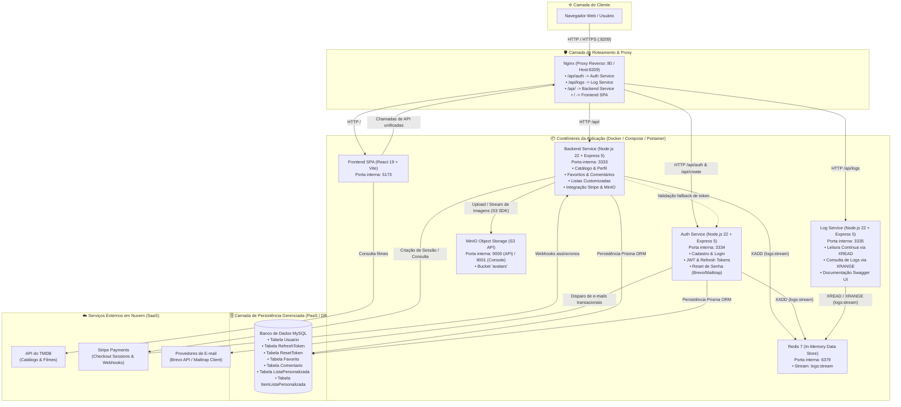

# Documentação Técnica e Reversa do Sistema — CineHanks

Esta documentação consolida a análise técnica reversa, especificação funcional, modelo de arquitetura em nuvem e levantamento completo de regras de negócio da plataforma **CineHanks**, desenvolvida sob a arquitetura de microserviços e contêineres.

---

## 1. Documentação Reversa — Especificação Funcional

> **Contexto de Análise:** Esta especificação descreve detalhadamente o funcionamento da plataforma CineHanks a partir da análise aprofundada do código-fonte herdado, sob a perspectiva de experiência do usuário final e das personas que operam a aplicação.

O **CineHanks** é uma plataforma temática interativa dedicada à filmografia do ator Tom Hanks. A aplicação oferece uma experiência rica de consumo cinematográfico, comunidade, gestão de perfis e monetização por assinatura. A seguir estão detalhados os módulos funcionais:

### 1.1. Cadastro, Autenticação e Gestão de Sessão
- **Registro de Conta**: O visitante pode criar uma conta informando nome completo, e-mail e senha. As senhas são protegidas com salt e hash criptográfico (bcrypt).
- **Login e Persistência de Sessão**: Ao efetuar login com credenciais válidas, o usuário recebe um token de acesso de curta duração (JWT, válido por 15 minutos) e um `RefreshToken` opaco e aleatório (UUID v4 persistido no MySQL, válido por 7 dias). Isso garante que o usuário permaneça autenticado mesmo após fechar o navegador, com renovação automática e silenciosa em segundo plano (`/refresh`).
- **Encerramento de Sessão (Logout)**: Invalida a sessão removendo o registro correspondente do `RefreshToken` no banco de dados e limpando os dados em memória no cliente, registrando o encerramento no serviço de auditoria.
- **Recuperação de Senha por E-mail**: Caso o usuário esqueça sua senha, o sistema permite solicitar a redefinição via formulário público. Um token temporário de redefinição com validade de 1 hora é gerado e enviado por e-mail com layout estilizado via Brevo (ou Mailtrap como contingência). O link redireciona para uma tela de redefinição onde o usuário define sua nova senha com segurança.

### 1.2. Catálogo de Filmes e Detalhes
- **Exploração e Metadados**: A aplicação consome a API do TMDB em tempo real, listando os filmes em que Tom Hanks atuou, exibindo capa original, título em português e original, ano de produção, média de avaliação e o papel/personagem interpretado.
- **Busca Instantânea e Filtros Dinâmicos**: A barra de pesquisa permite filtrar os títulos por nome do filme, nome do personagem ou ano de lançamento, contando com paginação visual interativa.
- **Modal de Detalhes**: Ao clicar em qualquer título, abre-se uma tela modal com a sinopse completa, ficha técnica, lista de comentários dos usuários e atalhos para favoritar ou adicionar a listas customizadas.

### 1.3. Sistema de Favoritos
- **Marcação Rápida**: Usuários autenticados podem marcar e desmarcar filmes favoritos com um clique no ícone de coração dos cards ou no modal de detalhes.
- **Sincronização em Nuvem**: A lista de favoritos é salva no banco de dados relacional, permitindo que o usuário consulte sua coleção pessoal tanto na home quanto na aba exclusiva do seu Perfil.

### 1.4. Comunidade e Comentários
- **Comentários por Filme**: Usuários autenticados podem postar suas opiniões em qualquer filme. Os comentários exibem o nome do autor, sua foto de perfil, data/hora da postagem e o selo distintivo caso o usuário seja assinante Premium.
- **Autonomia de Exclusão**: Cada usuário comum possui o direito de apagar apenas os comentários redigidos por ele mesmo.

### 1.5. Perfil do Usuário e Foto de Avatar (MinIO S3)
- **Painel Central de Perfil**: Exibe todos os dados do usuário logado: avatar, nome, e-mail, biografia, role do sistema (`USER` ou `ADMIN`), plano atual (`FREE` ou `PREMIUM`) e data de ingresso.
- **Edição de Bio e Nome**: Permite atualizar o nome de exibição e registrar uma biografia pessoal de até 250 caracteres.
- **Upload e Remoção de Avatar via Object Storage**: O usuário pode fazer o upload de fotos nos formatos JPG, PNG, WEBP ou GIF (até 5MB). O arquivo binário é transmitido diretamente ao bucket `avatars` no servidor **MinIO (S3)** e servido com cache HTTP otimizado. Ao atualizar ou remover a foto, a versão antiga é automaticamente expurgada do bucket, evitando lixo digital na nuvem.

### 1.6. Plano Premium e Monetização (Integração Stripe)
- **Plano Gratuito (Free)**: Usuários recém-cadastrados entram no plano gratuito, com limites de engajamento: até 5 filmes favoritados e até 5 comentários postados.
- **Benefícios do Plano Premium**:
  - Favoritos ilimitados.
  - Comentários ilimitados na comunidade.
  - Selo visual VIP dourado (*Premium Member*) exibido ao lado do nome em comentários e no perfil.
  - **Listas Personalizadas**: Funcionalidade exclusiva que permite ao assinante criar coleções temáticas próprias (ex.: "Favoritos dos Anos 90", "Dramas Emocionantes") com título e descrição customizados, gerenciando os filmes inclusos livremente.
- **Jornada de Assinatura com Stripe**:
  - Integração via **Stripe Checkout**: Redireciona o usuário para uma página de pagamento segura e hospedada pela Stripe (R$ 19,90/mês).
  - **Portal de Cobrança (Stripe Customer Portal)**: Se um usuário já for Premium, o sistema permite acessar o portal da Stripe para alterar dados de cartão ou cancelar o plano.
  - **Webhooks Assíncronos**: Eventos como `checkout.session.completed` e `customer.subscription.deleted` atualizam o status no banco de forma resiliente e segura.
  - **Modo Mock/Dev**: O sistema possui fallback transparente para ambiente de desenvolvimento e testes rápidos caso as credenciais da Stripe não estejam configuradas.

### 1.7. Painel de Moderação e Auditoria de Logs (Exclusivo para ADMIN)
- **Moderação Global de Conteúdo**: Administradores têm acesso a uma interface administrativa para buscar, visualizar e **excluir qualquer comentário** de qualquer usuário da plataforma, garantindo a moderação e segurança comunitária.
- **Auditoria de Logs em Tempo Real**: Microserviço dedicado (`log-service`) que consome eventos do **Redis Streams** (`logs:stream`), gravando registros estruturados com data/hora, endereço IP de origem, identificador do usuário e ação executada (ex.: `LOGIN`, `LOGOUT`, `CREATE_COMMENT`, `DELETE_COMMENT`, `FAVORITE_MOVIE`, `CREATE_CUSTOM_LIST`, `PERMISSION_DENIED`, `ERROR`). Permite rastreamento completo de atividades suspeitas e conformidade com segurança.

---

## 2. Documentação Reversa — Arquitetura do Sistema ("Big Picture")

A arquitetura do CineHanks é distribuída em microserviços e contêineres Docker, interligados por rede interna privada e orquestrados por proxy reverso unificado.

### 2.1. Diagrama Geral de Arquitetura (Mermaid)

### 2.2. Fluxo e Papel dos Componentes
1. **Ponto Único de Entrada (Nginx)**: O Nginx atua como *API Gateway* e proxy reverso. Nenhuma porta de microsserviço além da porta pública do Nginx (`8209:80`) é exposta para o ambiente externo, garantindo segurança e evitando problemas de CORS entre frontend e APIs.
2. **Desacoplamento de Responsabilidades**:
   - `auth-service`: Cuida exclusivamente da identidade, ciclo de vida de tokens, criptografia de credenciais e comunicação com serviços de e-mail (Brevo/Mailtrap).
   - `backend`: Concentra as regras de negócio de domínio (filmes, comentários, favoritos, listas personalizadas, upload S3 e faturamento Stripe).
   - `log-service`: Opera de forma assíncrona, desacoplado dos serviços de negócio, lendo continuamente o stream do Redis sem bloquear o tempo de resposta das requisições principais.
3. **Mensageria com Redis Streams**: Utiliza comandos de stream (`XADD`, `XREAD`, `XRANGE`) para garantir que eventos de auditoria fiquem enfileirados e persistidos em memória/disco com ordenação temporal estrita.

---

## 3. Documentação Reversa — Regras de Negócio (Extraídas do Código)

Abaixo estão listadas todas as regras de negócio implementadas no código-fonte, estruturadas rigorosamente na lógica **"Se X, então Y"**:

### 3.1. Cadastro, Autenticação e Gestão de Contas
1. **Se** o usuário enviar uma requisição de cadastro sem informar `nome`, `email` ou `password`, **então** a requisição é rejeitada com status **HTTP 400** e mensagem `"Nome, email e senha são obrigatórios."`.
2. **Se** o e-mail informado no cadastro já existir na base de dados (`prisma.usuario.findUnique`), **então** o cadastro é cancelado retornando **HTTP 400** com `"User exists"`.
3. **Se** o campo `role` enviado no cadastro for `"admin"`, **então** a conta é criada com perfil de administrador; caso contrário, **então** o sistema atribui compulsoriamente a role padrão `"user"`.
4. **Se** um novo usuário for criado, **então** seu status inicial de `isPremium` é gravado no banco como `false`.
5. **Se** o usuário tentar efetuar login informando senha incorreta que não coincide com o hash gravado, **então** a autenticação é negada com **HTTP 401** e `"Password invalid"`.
6. **Se** o login for autenticado com sucesso, **então** o sistema emite um token JWT com validade de 15 minutos, gera um `RefreshToken` criptograficamente seguro (UUID v4) válido por 7 dias gravado na tabela `RefreshToken`, e emite um evento `LOGIN` no Redis Stream.
7. **Se** o `RefreshToken` enviado para renovação não existir no banco, **então** a renovação é negada com **HTTP 401** (`"Invalid refresh token"`).
8. **Se** o `RefreshToken` enviado estiver com data de validade expirada (`expiresAt < new Date()`), **então** o token é deletado do banco e a operação retorna **HTTP 401** (`"Refresh token expired"`).
9. **Se** a renovação for aprovada, **então** um novo JWT de 15 minutos é gerado contendo o ID atualizado, role e status premium do usuário.
10. **Se** o usuário acionar o logout, **então** o `RefreshToken` correspondente é excluído da tabela `RefreshToken` e um evento `LOGOUT` é enviado ao Redis Stream.
11. **Se** o usuário solicitar recuperação de senha para um e-mail cadastrado, **então** um `ResetToken` com validade de 1 hora (60 minutos) é criado e um e-mail transacional é despachado via Brevo API (ou Mailtrap); se o e-mail não existir, **então** a API retorna **HTTP 404** (`"User not found"`).
12. **Se** o token de redefinição de senha já foi utilizado (`usado === true`), **então** a tentativa de redefinição é rejeitada com **HTTP 400** (`"Este token de redefinição já foi utilizado."`).
13. **Se** o token de redefinição estiver expirado no momento da confirmação (`expiresAt < new Date()`), **então** a confirmação é rejeitada com **HTTP 400** (`"Este token de redefinição expirou."`).
14. **Se** a nova senha for validada com sucesso, **então** a senha do usuário é atualizada com novo hash bcrypt, o token é marcado como `usado = true` e o sistema retorna mensagem de sucesso.

### 3.2. Segurança e Controle de Acesso (Middlewares)
15. **Se** uma rota protegida por `AuthMiddleware` for acionada sem o cabeçalho `Authorization: Bearer <token>`, **então** o acesso é barrado com status **HTTP 401** (`"Token not provided"`).
16. **Se** o token JWT recebido pelo backend não puder ser verificado localmente, **então** o backend realiza uma chamada de contingência ao endpoint `/auth/verify` do `auth-service`; se a validação externa também falhar, **então** retorna **HTTP 401** (`"Token invalid"`).
17. **Se** um usuário sem papel de administrador (`role !== "admin"`) tentar acessar endpoints protegidos por `AdminMiddleware` (como `/comment/admin/all` ou `/api/logs`), **então** a requisição é bloqueada com **HTTP 403** (`"Acesso restrito para administradores."`) e um evento `PERMISSION_DENIED` é gravado no Redis Stream.

### 3.3. Perfil do Usuário e Avatar (MinIO S3)
18. **Se** o usuário autenticado requisitar a alteração de seu perfil (`nome`, `bio`), **então** apenas os dados do registro associado ao seu próprio `req.userId` são modificados.
19. **Se** o usuário tentar realizar upload de avatar sem fornecer um arquivo na requisição (`req.file`), **então** a operação retorna **HTTP 400** (`"Nenhum arquivo de imagem foi enviado."`).
20. **Se** o arquivo enviado no upload de foto de perfil possuir extensão ou MIME type diferente de JPG, PNG, WEBP ou GIF, **então** a operação é cancelada com **HTTP 400** (`"Formato de arquivo inválido. Apenas imagens (JPG, PNG, WEBP, GIF) são permitidas."`).
21. **Se** o arquivo enviado ultrapassar o tamanho de 5MB (5.242.880 bytes), **então** a requisição é rejeitada com **HTTP 400** (`"O tamanho da imagem não pode ultrapassar 5MB."`).
22. **Se** o usuário já possuir uma foto de perfil anterior no MinIO e enviar um novo avatar ou solicitar exclusão, **então** o arquivo binário anterior é fisicamente deletado do bucket no MinIO antes de associar a nova URL ou limpar o campo no MySQL.

### 3.4. Favoritos e Limitações por Plano
23. **Se** o usuário pertencer ao Plano Gratuito (`isPremium === false`) e já possuir **5 ou mais filmes favoritados**, **então** a tentativa de adicionar outro favorito é bloqueada com **HTTP 403** e indicador `limitReached: true`.
24. **Se** o usuário for assinante do Plano Premium (`isPremium === true`), **então** o limite de favoritos é desativado, permitindo inclusões ilimitadas.
25. **Se** o filme já estiver presente na lista de favoritos do usuário, **então** o sistema não duplica o registro e retorna o objeto existente com **HTTP 200**.
26. **Se** um usuário tentar deletar um favorito, **então** o sistema só permite a exclusão se o registro pertencer explicitamente ao seu próprio `usuarioId`.

### 3.5. Comentários e Moderação
27. **Se** a postagem de comentário contiver texto vazio ou apenas espaços em branco, **então** a requisição é rejeitada com **HTTP 400** (`"O texto do comentário é obrigatório."`).
28. **Se** o usuário for do Plano Gratuito (`isPremium === false`) e já tiver publicado **5 comentários na plataforma**, **então** novas publicações são bloqueadas com **HTTP 403** e `limitReached: true`.
29. **Se** o usuário for assinante Premium, **então** ele pode postar quantos comentários desejar sem qualquer bloqueio de cota.
30. **Se** um usuário solicitar a exclusão de um comentário e NÃO for o autor do comentário nem possuir perfil de administrador, **então** a exclusão é rejeitada com **HTTP 403** (`"Você não tem permissão para deletar este comentário."`) e o evento `PERMISSION_DENIED` é registrado.
31. **Se** o usuário for administrador (`role === "admin"`), **então** ele tem permissão para excluir qualquer comentário de qualquer usuário na plataforma.

### 3.6. Listas Personalizadas (Funcionalidade Exclusiva Premium)
32. **Se** um usuário do Plano Gratuito tentar criar uma lista personalizada (`POST /api/custom-list`), **então** o acesso é barrado com **HTTP 403** (`"Recurso exclusivo do Plano Premium."`).
33. **Se** o usuário for Premium, **então** ele pode criar listas customizadas com título e descrição para curadoria própria.
34. **Se** um usuário tentar adicionar ou remover filmes de uma lista que não pertence à sua conta, **então** o sistema retorna **HTTP 404** (`"Lista não encontrada."`), impedindo acesso indevido.
35. **Se** um filme já estiver incluído dentro da lista personalizada, **então** o sistema não insere duplicidade e retorna o item existente com **HTTP 200**.

### 3.7. Assinatura Stripe e Monetização
36. **Se** um usuário que já é Premium solicitar criação de checkout session, **então** o sistema redireciona o usuário para a sessão do Stripe Billing Portal (gestão de cartão e cancelamento) em vez de gerar nova cobrança duplicada.
37. **Se** as credenciais secretas da Stripe não estiverem presentes no ambiente, **então** o sistema ativa o modo mock/teste automático, permitindo simular a transição para Premium sem falha de execução.
38. **Se** o webhook da Stripe receber o evento assíncrono `checkout.session.completed`, **então** o usuário correspondente é atualizado no MySQL com `isPremium = true`, gravando `stripeCustomerId` e `stripeSubscriptionId`.
39. **Se** o webhook receber o evento `customer.subscription.deleted`, **então** o status do usuário é revertido para `isPremium = false` e a assinatura é desvinculada.
40. **Se** o usuário solicitar o cancelamento via `/stripe/cancel`, **então** a assinatura é cancelada na API da Stripe e o status no MySQL é revertido para `isPremium = false`.
41. **Se** o usuário carregar seu perfil e possuir assinatura ativa na Stripe que ainda não estava sincronizada no banco de dados local, **então** o backend efetua uma auto-sincronização automática com a Stripe atualizando o banco para `isPremium = true`.

### 3.8. Auditoria e Telemetria (Redis Streams)
42. **Se** qualquer ação relevante for executada (como `LOGIN`, `LOGOUT`, `FAVORITE_MOVIE`, `CREATE_COMMENT`, `DELETE_COMMENT`, `CREATE_CUSTOM_LIST`, `PERMISSION_DENIED` ou `ERROR`), **então** o backend invoca `XADD` no stream `logs:stream` do Redis registrando `user_id`, `acao`, `timestamp` e o endereço IP do cliente.
43. **Se** o servidor Redis estiver temporariamente offline ou inacessível, **então** a falha de log é tratada de forma silenciosa para garantir que a navegação do usuário não seja interrompida.
44. **Se** um administrador consultar o endpoint `/api/logs`, **então** o `log-service` recupera o histórico ordenado via `XRANGE` do Redis Streams e entrega o relatório de auditoria em formato JSON.
