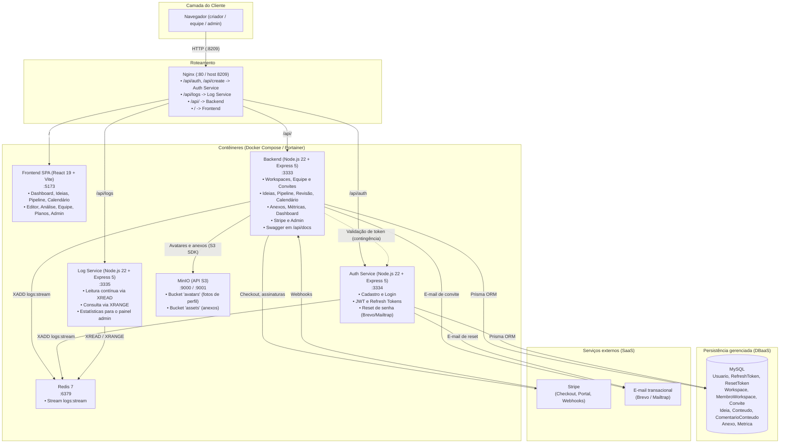

# Documentação Técnica do Sistema — Kreato

Esta documentação consolida a especificação funcional, a arquitetura e as regras de negócio da plataforma **Kreato**, um SaaS para criadores de conteúdo e pequenas equipes de criação, construído em microsserviços e contêineres. As regras foram levantadas diretamente do código-fonte.

> **Origem:** o Kreato reaproveita a base técnica de um projeto anterior (autenticação distribuída, MinIO, Redis Streams, Stripe e Nginx) e substitui todo o domínio de negócio. O mapeamento do que cada peça virou está no `README.md`.

**Documentação interativa das APIs (Swagger UI):**

| Serviço | Swagger UI | Especificação |
|---|---|---|
| Backend (API principal) | `/api/docs` | `/api/openapi.json` |
| Auth Service | `/auth/apidocs` | `/auth/openapi.json` (e `openapi-auth.yaml`) |
| Log Service | `/log/apidocs` | `/log/openapi.json` |

---

## 1. Especificação Funcional

O **Kreato** é a central de gestão e produção de conteúdo para TikTok, Instagram e YouTube. O criador registra ideias, leva as melhores para um pipeline de produção, revisa roteiros com a equipe, agenda publicações, acompanha o desempenho de cada post e trabalha com colaboradores dentro de um workspace compartilhado.

### 1.1. Cadastro, Autenticação e Sessão
- **Cadastro:** nome, e-mail e senha (hash bcrypt). Toda conta nova nasce com `role = "creator"` e plano `FREE`.
- **Login e sessão:** o login devolve um JWT de 15 minutos e um `RefreshToken` opaco (UUID v4) de 7 dias, gravado no MySQL. O frontend renova o JWT em segundo plano (`/api/auth/refresh`).
- **Logout:** apaga o `RefreshToken` do banco e limpa a sessão do navegador.
- **Recuperação de senha:** gera um token de redefinição válido por 1 hora, enviado por e-mail (Brevo, com Mailtrap como contingência).
- **Convite ao cadastrar:** quem chega por um link de convite é levado ao cadastro/login com o e-mail do convite já preenchido e volta para a tela de aceite.

### 1.2. Workspaces e Equipe
- **Workspace pessoal:** todo usuário tem um workspace próprio, criado automaticamente no primeiro acesso, do qual é o `DONO`.
- **Troca de workspace:** quem participa de mais de um workspace alterna entre eles pelo seletor da barra lateral. A escolha fica salva no navegador e é enviada em todas as requisições no header `X-Workspace-Id`.
- **Papéis no workspace:**
  - `DONO`: controle total, inclusive plano e assinatura (que pertencem a ele).
  - `GESTOR`: gerencia conteúdo, aprova roteiros, agenda/publica e administra a equipe (exceto outros gestores).
  - `ROTEIRISTA`: cria e escreve conteúdos nas etapas Ideia e Roteiro.
  - `EDITOR`: trabalha na produção, movendo conteúdos entre Gravação e Edição.
- **Convites por e-mail:** DONO e GESTOR convidam pessoas informando e-mail e papel. O convite vale 7 dias e pode ser reenviado (gera novo link) ou cancelado. O link mostra uma tela pública de aceite.
- **Página de equipe:** lista de membros, troca de papel, remoção, convites pendentes/expirados, vagas do plano e opção de sair do workspace.
- **Meta semanal:** o workspace define quantas publicações por semana quer fazer (padrão 3).

### 1.3. Banco de Ideias
- Captura rápida de ideias com título, gancho, descrição, legenda, plataforma, tags e status (`NOVA`, `EM_DESENVOLVIMENTO`, `ARQUIVADA`).
- Filtros por status, plataforma, tag e busca textual.
- **Levar para o pipeline:** converte a ideia em um conteúdo, copiando título, legenda, plataforma e tags (como hashtags) e montando o rascunho do roteiro com o gancho e a descrição.

### 1.4. Pipeline de Produção (Kanban)
- Colunas: `IDEIA` → `ROTEIRO` → `GRAVACAO` → `EDICAO` → `AGENDADO` → `PUBLICADO`.
- Cards arrastáveis entre colunas (ordenados pela `posicao` dentro de cada coluna), com filtros por plataforma, formato e busca.
- Cada conteúdo tem título, roteiro, legenda, hashtags, plataforma, formato (`VIDEO_CURTO`, `VIDEO_LONGO`, `CARROSSEL`, `IMAGEM`, `STORY`, `LIVE`), data e link de publicação.
- **Editor de conteúdo:** tela dedicada com contador de caracteres da legenda, stepper de etapas, anexos, métricas e painel de revisão. Campos e botões que o papel não pode usar aparecem bloqueados, com o motivo.

### 1.5. Revisão de Roteiro e Comentários
- Qualquer membro comenta um conteúdo. Comentários podem ser resolvidos e reabertos.
- DONO e GESTOR **aprovam o roteiro** (o conteúdo segue para Gravação) ou **pedem ajustes** (o conteúdo volta para Roteiro e a aprovação é desfeita).
- Os cards mostram o selo de roteiro aprovado e a contagem de comentários em aberto.

### 1.6. Calendário Editorial
- Grade mensal com os conteúdos que têm data de publicação, identificados por plataforma.
- Reagendamento arrastando o card para outro dia (só para DONO/GESTOR e nunca para conteúdos já publicados).
- Lista lateral com os conteúdos em produção ainda sem data, para planejar.

### 1.7. Anexos (MinIO S3)
- Upload de arquivos brutos por conteúdo (vídeos, áudios, imagens, PDFs, textos e documentos do Office), até 100 MB por arquivo.
- Os arquivos ficam no bucket `assets` do MinIO e só são baixados por membros do workspace, através do backend.

### 1.8. Métricas de Desempenho
- Registro manual de visualizações, curtidas, comentários, compartilhamentos, salvamentos, alcance e seguidores ganhos, em vários momentos (evolução ao longo do tempo).
- Taxa de engajamento = interações ÷ visualizações, em %.
- **Página de análise:** totais do período, comparação por plataforma e por formato, ranking dos conteúdos e gráficos.

### 1.9. Painel Inicial (Dashboard)
- Progresso da meta semanal, sequência de semanas cumpridas e histórico das últimas 8 semanas.
- Contagem de conteúdos por etapa, agenda dos próximos dias e conteúdos atrasados.
- Ideias recentes e o destaque de desempenho dos últimos 30 dias.

### 1.10. Planos e Assinatura (Stripe)

| Recurso | Free | Creator (R$ 29,90/mês) | Studio (R$ 79,90/mês) |
|---|---|---|---|
| Ideias ativas | 50 | ilimitadas | ilimitadas |
| Conteúdos ativos no pipeline | 15 | ilimitados | ilimitados |
| Armazenamento de anexos | 100 MB | 2 GB | 10 GB |
| Histórico de métricas | 30 dias | ilimitado | ilimitado |
| Membros no workspace | 1 | 1 | 5 |

- Assinatura pelo **Stripe Checkout**; troca entre planos pagos com cobrança proporcional; gestão de cartão pelo **Customer Portal**; cancelamento pela página de planos.
- Os **webhooks** do Stripe mantêm o plano sincronizado com a assinatura.
- Fora de produção há uma **ativação simulada** para testar os planos sem pagamento.
- Ao atingir um limite, o frontend mostra o aviso e o atalho para a página de planos.

### 1.11. Painel Administrativo (role `admin`)
- Métricas da plataforma inteira: usuários por plano, novos cadastros, pagantes, MRR estimado, workspaces com equipe, convites pendentes, conteúdos por etapa, publicações, roteiros aprovados, comentários e armazenamento.
- Eventos de uso e segurança vindos do `log-service`: eventos por dia, usuários ativos, logins, acessos negados, erros, limites atingidos e eventos de segurança recentes.
- Seletor de período (7, 30 ou 90 dias). A role `admin` é atribuída diretamente no banco; não existe cadastro de administrador pela API.

---

## 2. Arquitetura do Sistema

O Kreato é distribuído em microsserviços Docker interligados por rede interna e expostos por um único proxy reverso.

### 2.1. Diagrama Geral (Mermaid)

### 2.2. Papel dos Componentes
1. **Ponto único de entrada (Nginx):** só a porta do Nginx (`8209:80`) é publicada. Frontend e APIs ficam na mesma origem, sem problemas de CORS.
2. **Separação de responsabilidades:**
   - `auth-service`: identidade, senhas, emissão e renovação de tokens e e-mail de redefinição de senha.
   - `backend`: todo o domínio do Kreato (workspaces, equipe, ideias, pipeline, revisão, anexos, métricas, dashboard, cobrança e métricas de admin).
   - `log-service`: auditoria assíncrona. Lê o stream do Redis sem afetar o tempo de resposta das APIs e calcula as estatísticas do painel admin.
3. **Isolamento por workspace:** toda entidade de conteúdo (ideia, conteúdo, comentário, anexo, métrica, convite) carrega o `workspaceId`. O `WorkspaceMiddleware` resolve o workspace de cada requisição e as consultas sempre filtram por ele.
4. **Limites pelo plano do dono:** os limites de uso vêm do plano do DONO do workspace, não do plano de quem faz a requisição. Assim um colaborador Free trabalha normalmente no workspace de um assinante Studio.
5. **Mensageria com Redis Streams:** `XADD` nos serviços de negócio, `XREAD` contínuo e `XRANGE` sob demanda no `log-service`, que mantém um buffer em memória quando o Redis está fora do ar.

### 2.3. Modelo de Dados (resumo)

| Tabela | Conteúdo |
|---|---|
| `Usuario` | Conta, `role` (`creator`/`admin`), `plano`, IDs do Stripe, bio e foto |
| `RefreshToken` / `ResetToken` | Sessões e redefinição de senha |
| `Workspace` | Nome, dono, meta semanal; `pessoalDoUsuarioId` garante um workspace pessoal por usuário |
| `MembroWorkspace` | Vínculo usuário ↔ workspace com o papel |
| `Convite` | E-mail, papel, hash SHA-256 do token, status e validade |
| `Ideia` | Banco de ideias, com tags em JSON |
| `Conteudo` | Item do pipeline: etapa, posição, textos, publicação, aprovação do roteiro, ideia de origem |
| `ComentarioConteudo` | Comentários de revisão (`COMENTARIO`, `APROVACAO`, `AJUSTE`), com resolução |
| `Anexo` | Metadados do arquivo e chave no bucket `assets` |
| `Metrica` | Medições de desempenho de um conteúdo em um momento |

---

## 3. Regras de Negócio (Extraídas do Código)

As regras abaixo seguem o formato **"Se X, então Y"**.

### 3.1. Cadastro, Autenticação e Sessão
1. **Se** o cadastro não trouxer `nome`, `email` ou `password`, **então** retorna **HTTP 400** (`"Nome, email e senha são obrigatórios."`).
2. **Se** o e-mail já estiver cadastrado, **então** retorna **HTTP 400** (`"User exists"`).
3. **Se** uma conta for criada, **então** ela recebe `role = "creator"` e `plano = "FREE"`, independentemente do que for enviado no corpo.
4. **Se** o e-mail do login não existir, **então** retorna **HTTP 404**; **se** a senha não conferir com o hash, **então** retorna **HTTP 401** (`"Password invalid"`).
5. **Se** o login for válido, **então** são emitidos um JWT de 15 minutos (com `id` e `role`) e um `RefreshToken` de 7 dias, e o evento `LOGIN` vai para o Redis.
6. **Se** o `RefreshToken` não existir, **então** retorna **HTTP 401** (`"Invalid refresh token"`); **se** estiver expirado, **então** é apagado e retorna **HTTP 401** (`"Refresh token expired"`).
7. **Se** o usuário fizer logout, **então** o `RefreshToken` é apagado e o evento `LOGOUT` é registrado.
8. **Se** for pedida a redefinição de senha de um e-mail cadastrado, **então** é criado um token válido por 1 hora e enviado por e-mail; **se** o e-mail não existir, **então** retorna **HTTP 404**.
9. **Se** o token de redefinição já tiver sido usado ou estiver expirado, **então** retorna **HTTP 400**; caso contrário a senha é trocada e o token marcado como usado.

### 3.2. Segurança e Acesso
10. **Se** uma rota protegida for chamada sem `Authorization: Bearer <token>`, **então** retorna **HTTP 401** (`"Token not provided"`).
11. **Se** o backend não conseguir validar o JWT localmente, **então** consulta `/auth/verify` no `auth-service`; **se** essa validação também falhar, **então** retorna **HTTP 401** (`"Token invalid"`).
12. **Se** um usuário sem `role = "admin"` chamar uma rota de administração (`/api/admin/metricas`, `/api/logs`, `/api/logs/stats`), **então** retorna **HTTP 403** (`"Acesso restrito para administradores."`).
13. **Se** o header `X-Workspace-Id` apontar para um workspace do qual o usuário não é membro, **então** retorna **HTTP 403** com `code: "WORKSPACE_FORBIDDEN"`, registra `PERMISSION_DENIED`, e o frontend descarta a seleção e volta ao workspace pessoal.
14. **Se** o header `X-Workspace-Id` não for enviado, **então** a requisição usa o workspace pessoal do usuário, que é criado na hora caso ainda não exista.
15. **Se** um registro (ideia, conteúdo, comentário, anexo, métrica, convite) pertencer a outro workspace, **então** a API responde **HTTP 404**, como se ele não existisse.

### 3.3. Perfil e Avatar (MinIO)
16. **Se** o upload de avatar vier sem arquivo, **então** retorna **HTTP 400**; **se** não for JPG, PNG, WEBP ou GIF, ou passar de 5 MB, **então** retorna **HTTP 400**.
17. **Se** o usuário trocar ou remover a foto, **então** o arquivo anterior é apagado do bucket `avatars`.

### 3.4. Workspaces e Equipe
18. **Se** quem tenta renomear o workspace ou mudar a meta semanal não for DONO ou GESTOR, **então** retorna **HTTP 403**; **se** a meta não for um inteiro entre 1 e 21, **então** retorna **HTTP 400**.
19. **Se** um GESTOR tentar alterar ou remover outro GESTOR (ou o DONO), **então** retorna **HTTP 403**; só o DONO gerencia gestores.
20. **Se** alguém tentar alterar o próprio papel, **então** retorna **HTTP 400**; o papel `DONO` não pode ser atribuído nem retirado de ninguém.
21. **Se** o DONO tentar sair do próprio workspace, **então** retorna **HTTP 400**; os demais membros podem sair a qualquer momento.

### 3.5. Convites
22. **Se** um GESTOR tentar convidar, reenviar ou cancelar convite de outro GESTOR, **então** retorna **HTTP 403**; só o DONO convida gestores.
23. **Se** o e-mail já for de um membro, **então** retorna **HTTP 409** (`ALREADY_MEMBER`); **se** já houver convite pendente para ele, **então** retorna **HTTP 409** (`INVITE_ALREADY_PENDING`).
24. **Se** membros + convites pendentes já ocuparem todas as vagas do plano do dono, **então** retorna **HTTP 403** (`PLAN_LIMIT_REACHED`). Convites pendentes ocupam vaga.
25. **Se** o workspace já tiver enviado 20 convites nas últimas 24 horas, **então** retorna **HTTP 429**.
26. **Se** um convite for criado ou reenviado, **então** um token aleatório é gerado, só o hash SHA-256 é salvo, a validade passa a ser de 7 dias e o link é enviado por e-mail (e devolvido a quem convidou para copiar).
27. **Se** o convite estiver expirado, aceito ou cancelado, **então** o aceite retorna **HTTP 410** (`INVITE_EXPIRADO`, `INVITE_ACEITO` ou `INVITE_REVOGADO`).
28. **Se** a conta logada tiver e-mail diferente do convite, **então** o aceite retorna **HTTP 403** (`INVITE_EMAIL_MISMATCH`).
29. **Se** no momento do aceite a equipe já estiver completa, **então** retorna **HTTP 403** (`PLAN_LIMIT_REACHED`); caso contrário o usuário vira membro com o papel do convite.

### 3.6. Ideias
30. **Se** a ideia não tiver título, **então** retorna **HTTP 400**. Título até 150 caracteres, gancho até 2.000, descrição até 5.000 e legenda até 2.200.
31. **Se** forem enviadas tags, **então** elas são normalizadas (sem `#`, minúsculas, sem duplicatas), com no máximo 10 tags de até 30 caracteres.
32. **Se** o workspace atingir o limite de ideias ativas do plano, **então** criar ou desarquivar uma ideia retorna **HTTP 403** (`PLAN_LIMIT_REACHED`). Ideias arquivadas não contam.
33. **Se** uma ideia já tiver sido levada para o pipeline, **então** uma nova conversão retorna **HTTP 409**. A conversão aceita as etapas Ideia, Roteiro, Gravação ou Edição (padrão: Roteiro).

### 3.7. Pipeline e Permissões por Papel
34. **Se** o papel for DONO ou GESTOR, **então** pode criar, editar, mover e excluir conteúdos em qualquer etapa.
35. **Se** o papel for ROTEIRISTA, **então** só cria conteúdos em Ideia/Roteiro, só edita os textos enquanto o conteúdo está nessas etapas e só move entre essas duas colunas.
36. **Se** o papel for EDITOR, **então** não cria conteúdos e só move entre Gravação e Edição.
37. **Se** um papel tentar uma ação fora do permitido, **então** retorna **HTTP 403** (`ROLE_FORBIDDEN`) e registra `PERMISSION_DENIED`.
38. **Se** alguém que não é DONO/GESTOR enviar `dataPublicacao` ou `urlPublicacao`, **então** retorna **HTTP 403** (`ROLE_FORBIDDEN`); agendar e publicar é papel de gestor.
39. **Se** o conteúdo for movido para `AGENDADO` sem data de publicação, **então** retorna **HTTP 400**; **se** for movido para `PUBLICADO` sem data, **então** a data vira o momento atual.
40. **Se** o link de publicação não for uma URL `http(s)` válida de até 500 caracteres, **então** retorna **HTTP 400**.
41. **Se** o workspace atingir o limite de conteúdos ativos do plano, **então** criar um conteúdo (ou tirar um de Publicado) retorna **HTTP 403** (`PLAN_LIMIT_REACHED`). Conteúdos publicados não contam no limite.
42. **Se** o ROTEIRISTA autor quiser excluir um conteúdo, **então** só consegue enquanto ele está em Ideia/Roteiro; excluir o conteúdo apaga também seus anexos (no MinIO) e métricas.

### 3.8. Revisão de Roteiro
43. **Se** um DONO/GESTOR mover o conteúdo de Ideia/Roteiro para a produção, **então** o roteiro fica aprovado (data e aprovador registrados); **se** o conteúdo voltar para Ideia/Roteiro, **então** a aprovação é desfeita.
44. **Se** alguém que não é DONO/GESTOR tentar aprovar ou pedir ajustes, **então** retorna **HTTP 403** (`ROLE_FORBIDDEN`).
45. **Se** o roteiro for aprovado pelo botão de aprovação, **então** o conteúdo precisa estar em Roteiro (senão **HTTP 409**), os ajustes pendentes são resolvidos, um comentário `APROVACAO` é registrado e o conteúdo vai para Gravação.
46. **Se** forem pedidos ajustes, **então** o conteúdo precisa estar em Roteiro ou Gravação, o texto é obrigatório, um comentário `AJUSTE` é criado, a aprovação é desfeita e o conteúdo volta para Roteiro.
47. **Se** alguém tentar editar um comentário que não escreveu, **então** retorna **HTTP 403**; resolver é permitido ao autor do comentário, ao autor do conteúdo e a DONO/GESTOR; excluir, ao autor do comentário e a DONO/GESTOR.

### 3.9. Anexos
48. **Se** o arquivo passar de 100 MB, **então** retorna **HTTP 413**; **se** o tipo não for vídeo, áudio, imagem (JPG, PNG, WEBP, GIF, HEIC), PDF, texto ou documento do Office, **então** retorna **HTTP 415**. SVG é recusado por poder conter scripts.
49. **Se** o arquivo fizer o workspace ultrapassar o armazenamento do plano, **então** retorna **HTTP 403** (`PLAN_LIMIT_REACHED`).
50. **Se** o registro no banco falhar depois do envio ao MinIO, **então** o objeto é apagado do bucket para não ficar órfão.
51. **Se** quem tenta excluir um anexo não for quem o enviou nem DONO/GESTOR, **então** retorna **HTTP 403**.

### 3.10. Métricas e Dashboard
52. **Se** o conteúdo não estiver em `PUBLICADO`, **então** registrar métricas retorna **HTTP 400** (`CONTENT_NOT_PUBLISHED`).
53. **Se** algum número não for inteiro entre 0 e 2 bilhões, ou a data da coleta estiver no futuro, **então** retorna **HTTP 400**.
54. **Se** o plano tiver histórico limitado (Free: 30 dias), **então** medições mais antigas ficam ocultas (e são contadas) e o resumo de análise tem o período cortado na janela do plano.
55. **Se** o conteúdo tiver visualizações, **então** a taxa de engajamento é (curtidas + comentários + compartilhamentos + salvamentos) ÷ visualizações, em %; sem visualizações ela é nula.
56. **Se** a semana em andamento ainda não atingiu a meta, **então** ela não quebra a sequência: a contagem começa da semana anterior (até 52 semanas para trás).

### 3.11. Assinatura (Stripe)
57. **Se** um usuário Free pedir um plano pago, **então** é aberta uma sessão do Stripe Checkout; **se** já assinar o mesmo plano, **então** é aberto o Customer Portal; **se** assinar outro plano pago, **então** o preço da assinatura é trocado com cobrança proporcional.
58. **Se** o retorno do Checkout for verificado, **então** a sessão precisa pertencer ao usuário (senão **HTTP 403**) e estar paga (senão **HTTP 402**) antes de liberar o plano.
59. **Se** o webhook não tiver assinatura válida (`Stripe-Signature`), **então** retorna **HTTP 400**; **se** `STRIPE_WEBHOOK_SECRET` não estiver configurado, **então** retorna **HTTP 503**.
60. **Se** chegar `checkout.session.completed`, **então** o plano comprado é aplicado; **se** chegar `customer.subscription.updated`, **então** o plano segue o status da assinatura (inativa = Free); **se** chegar `customer.subscription.deleted` da assinatura vigente, **então** o usuário volta ao Free.
61. **Se** o usuário cancelar, **então** a assinatura é cancelada no Stripe e o plano volta a Free; **se** o Stripe falhar, **então** retorna **HTTP 502** e nada muda.
62. **Se** o ambiente for de produção, **então** a ativação simulada de planos retorna **HTTP 403**.
63. **Se** o dono do workspace mudar de plano, **então** os limites de todo o workspace mudam na próxima requisição, porque o plano é lido do banco a cada chamada.

### 3.12. Auditoria e Painel Admin (Redis Streams)
64. **Se** uma ação relevante acontecer, **então** o serviço faz `XADD` em `logs:stream` com usuário, ação, IP, data/hora e, quando houver, entidade e detalhes. Ações registradas:
    - Sessão: `LOGIN`, `LOGOUT`.
    - Conteúdo: `IDEA_CREATED`, `IDEA_DELETED`, `IDEA_CONVERTED`, `CONTENT_CREATED`, `CONTENT_UPDATED`, `CONTENT_STAGE_CHANGED`, `CONTENT_DELETED`, `ATTACHMENT_UPLOADED`, `ATTACHMENT_DELETED`, `METRIC_RECORDED`, `METRIC_DELETED`.
    - Revisão: `COMMENT_CREATED`, `SCRIPT_APPROVED`, `SCRIPT_CHANGES_REQUESTED`.
    - Equipe: `WORKSPACE_UPDATED`, `MEMBER_INVITED`, `INVITE_RESENT`, `INVITE_REVOKED`, `INVITE_ACCEPTED`, `MEMBER_ROLE_CHANGED`, `MEMBER_REMOVED`, `MEMBER_LEFT`.
    - Cobrança: `CHECKOUT_STARTED`, `PLAN_CHANGED`, `CANCEL_SUBSCRIPTION`, `VERIFY_STRIPE_PAYMENT_SUCCESS`, `VERIFY_STRIPE_SESSION_REJECTED`.
    - Segurança: `PERMISSION_DENIED`, `PLAN_LIMIT_REACHED`, `ERROR`.
65. **Se** o Redis estiver fora do ar, **então** a falha de log é ignorada e a requisição do usuário segue normalmente.
66. **Se** um admin consultar `/api/logs`, **então** o `log-service` devolve o histórico via `XRANGE`; **se** consultar `/api/logs/stats?dias=N`, **então** recebe as estatísticas do período (1 a 90 dias, padrão 30), agrupadas por dia em UTC.
67. **Se** um admin abrir o painel de métricas, **então** dados do banco (`/api/admin/metricas`) e eventos (`/api/logs/stats`) são buscados em paralelo; **se** uma das fontes falhar, **então** a outra continua sendo exibida.
68. **Se** o MRR for calculado, **então** ele usa o preço de tabela de cada plano pago, como estimativa (cupons e impostos não entram).
